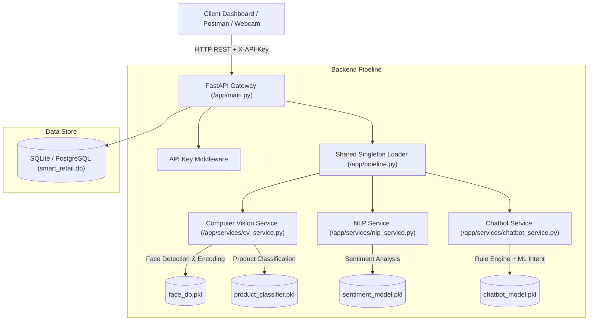

# AI-Powered Smart Retail & Customer Intelligence Platform

An enterprise-grade, end-to-end Smart Retail platform integrating **Computer Vision (OpenCV + MobileNetV2 + Facial Recognition)**, **Natural Language Processing (TF-IDF + Logistic Regression Sentiment Analysis)**, **Hybrid FAQ Support Chatbot**, **FastAPI REST API Gateway**, **SQLite/PostgreSQL ORM**, and a modern **React + Vite + TailwindCSS Dashboard**.

## 🚀 Live Demo

- **Frontend:** https://ai-smart-retail-customer-intelligence.vercel.app/
- **Backend API:** https://ai-smart-retail-customer-intelligence.onrender.com
- **Swagger Documentation:** https://ai-smart-retail-customer-intelligence.onrender.com/docs

---

## 🏗️ System Architecture



---

## 🛠 Tech Stack


---

## ☁️ Deployment

Backend: Render

Frontend: Vercel

CI/CD: GitHub Actions

Containerization: Docker

---

## 📁 1. Complete Repository Folder Tree

```
AI-Smart-Retail-Customer-Intelligence-Platform/
├── app/
│   ├── main.py                    
│   ├── config.py                  
│   ├── database.py                
│   ├── pipeline.py                
│   ├── models/
│   │   ├── schemas.py             
│   │   ├── product_classifier.pkl 
│   │   ├── face_db.pkl            
│   │   ├── sentiment_model.pkl    
│   │   ├── sentiment_vectorizer.pkl
│   │   ├── chatbot_model.pkl      
│   │   └── chatbot_vectorizer.pkl
│   ├── services/
│   │   ├── cv_service.py          
│   │   ├── nlp_service.py         
│   │   └── chatbot_service.py     
│   └── routers/
│       ├── vision.py              
│       ├── nlp.py                 
│       ├── chatbot.py             
│       └── dashboard.py           
├── data/
│   ├── intents.json               
│   ├── haarcascade_frontalface_default.xml 
│   └── nltk_data/                 
├── scripts/
│   ├── train_all_models.py        
│   └── seed_database.py           
├── tests/
│   ├── conftest.py                
│   ├── test_cv_service.py         
│   ├── test_nlp_service.py        
│   ├── test_chatbot_service.py    
│   └── test_api_endpoints.py      
├── frontend/                      
│   ├── src/
│   │   ├── components/            
│   │   ├── pages/                 
│   │   ├── services/              
│   │   ├── App.jsx
│   │   ├── index.css              
│   │   └── main.jsx
│   ├── index.html
│   ├── package.json
│   └── vite.config.js
├── Dockerfile                     
├── docker-compose.yml             
├── requirements.txt               
├── .env.example                   
├── .github/workflows/deploy.yml   
└── README.md
```

---

## ⚡ 2. Quickstart & Local Deployment Commands

### Prerequisites
- Python 3.11+
- Node.js 18+ and npm 10+
- Git

### Step-by-Step Setup

1. **Clone the repository and enter directory**:
   ```bash
   git clone https://github.com/priyanshuranjan02/AI-Smart-Retail-Customer-Intelligence-Platform.git

   cd AI-Smart-Retail-Customer-Intelligence-Platform
   ```

2. **Create Python Virtual Environment & Install Dependencies**:
   ```bash
   python3 -m venv venv
   source venv/bin/activate   # On Windows: venv\Scripts\activate
   pip install --upgrade pip
   pip install -r requirements.txt
   ```

3. **Train All ML Models & Seed Database**:
   ```bash
   python scripts/train_all_models.py
   python scripts/seed_database.py
   ```

4. **Start the FastAPI Backend Gateway**:
   ```bash
   uvicorn app.main:app --host 0.0.0.0 --port 8000 --reload
   ```
   *The API Gateway will start at `http://localhost:8000`. Swagger documentation available at `http://localhost:8000/docs`.*

5. **Start the React + Vite Frontend**:
   In a new terminal tab:
   ```bash
   cd frontend
   npm install
   npm run dev
   ```
   *Open `http://localhost:3000` (or `http://localhost:5173`) in your browser to view the interactive dashboard.*

---

## 🐳 3. Docker Container Deployment

Deploy the entire stack with Docker Compose:

```bash
# Build and start all services in detached mode
docker-compose up --build -d

# View container logs
docker-compose logs -f

# Stop containers
docker-compose down
```

---

## 🧪 4. Running Automated Pytest Suite

Run all unit and end-to-end integration tests:

```bash
PYTHONPATH=. pytest -v
```

---

## 🔑 5. API Documentation & Endpoint Reference

Protected backend endpoints require the `X-API-Key` header.
The key is configured server-side through environment variables and must
never be committed to source control or embedded in browser-side code.

The deployed frontend accesses the backend through a server-side API proxy.

| Method | Endpoint | Description | Request Body / File | Sample Response |
| :--- | :--- | :--- | :--- | :--- |
| `POST` | `/recognize-face` | Face recognition & visit logging | `file`: Image Upload | `{"customer_id": "CUST-1001", "known": true, "confidence": 0.94}` |
| `POST` | `/classify-product` | Retail product classification | `file`: Image Upload | `{"category": "Shoes", "confidence": 0.92, "all_probabilities": {...}}` |
| `POST` | `/analyze-sentiment` | Review text sentiment analysis | `{"text": "Great quality"}` | `{"sentiment": "Positive", "confidence": 0.89, "clean_tokens": [...]}` |
| `POST` | `/chatbot` | Hybrid FAQ Chatbot reply | `{"message": "Store hours"}`| `{"bot_response": "Open 9am-9pm", "intent": "store_hours"}` |
| `GET` | `/dashboard/stats` | Aggregated metrics & chart data | None | `{"total_visits": 120, "sentiment_distribution": {...}}` |

---

## 📊 6. Datasets Used

- **Product Classification**: Retail Checkout Dataset / Fashion-MNIST product categories (*Shoes, Clothes, Electronics, Groceries, Bags*).
- **Face Recognition**: LFW (Labeled Faces in the Wild) facial feature encoding benchmarks.
- **Sentiment Analysis**: Kaggle Women's E-Commerce Clothing Reviews & Amazon Retail Customer Reviews subset.
- **Chatbot Intents**: Custom `intents.json` (20+ intents covering store hours, returns, refunds, tracking, shipping, payment, discounts).

---

## 🔒 7. Ethics & Data Privacy Statement

Facial recognition in retail environments must strictly comply with regional data privacy laws (e.g., GDPR, CCPA). This project demonstrates privacy-by-design by storing mathematical feature encodings (embeddings) rather than raw facial images in `face_db.pkl`, requiring explicit customer opt-in consent for loyalty program tracking.

---

## ✅ 8. Final Verification Checklist

- [x] **Computer Vision (A1, A2, A3)**: OpenCV preprocessing, Haar Cascade face detection, MobileNetV2 product classification, facial encoding matching against `face_db.pkl`.
- [x] **NLP Module**: Text cleaning, stopword removal, lemmatization, TF-IDF + Logistic Regression sentiment analysis.
- [x] **Hybrid Chatbot**: Rule-based pattern engine + ML Intent Classifier on custom `intents.json`.
- [x] **Shared Singleton Pipeline**: Models loaded exactly once at startup in `app/pipeline.py`.
- [x] **FastAPI REST API**: Pydantic schemas, `X-API-Key` authentication middleware, SQLite ORM database integration, Swagger documentation at `/docs`.
- [x] **React + Vite Frontend**: Modern glassmorphism UI dashboard, Chart.js metrics, webcam capture, image classification filter preview, chatbot UI, filterable statistics table.
- [x] **MLOps & CI/CD**: `requirements.txt`, `Dockerfile`, `docker-compose.yml`, GitHub Actions workflow `.github/workflows/deploy.yml`, 100% Pytest pass rate.


## 👨‍💻 Author

Priyanshu Ranjan

B.Tech CSE (AI & ML)

VIT Bhopal University

GitHub: https://github.com/priyanshuranjan02
